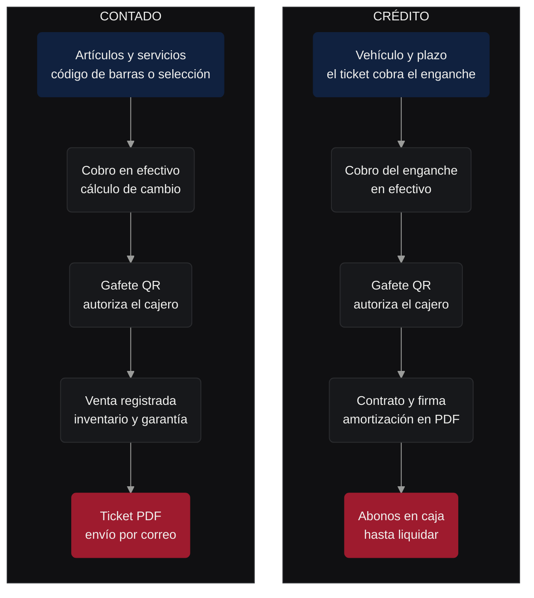
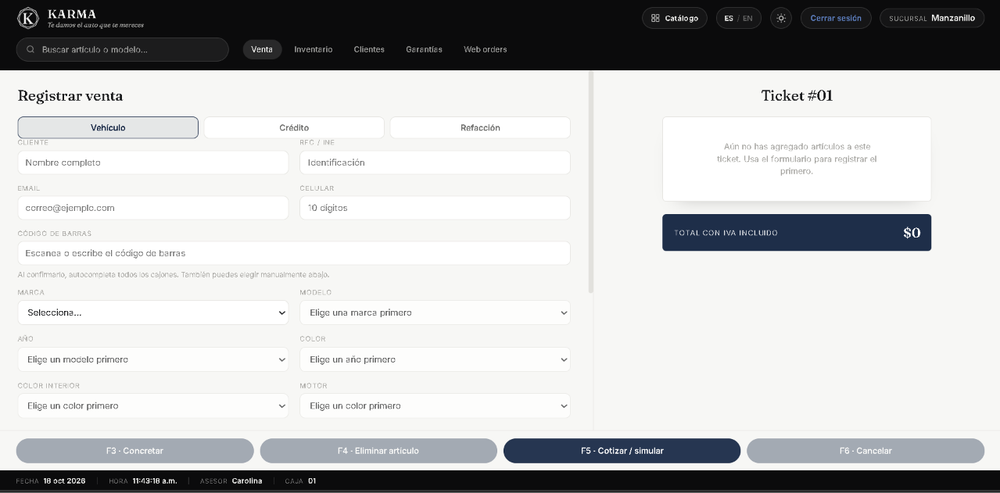
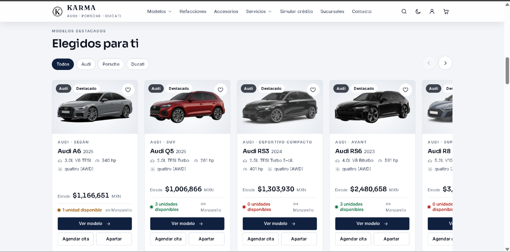
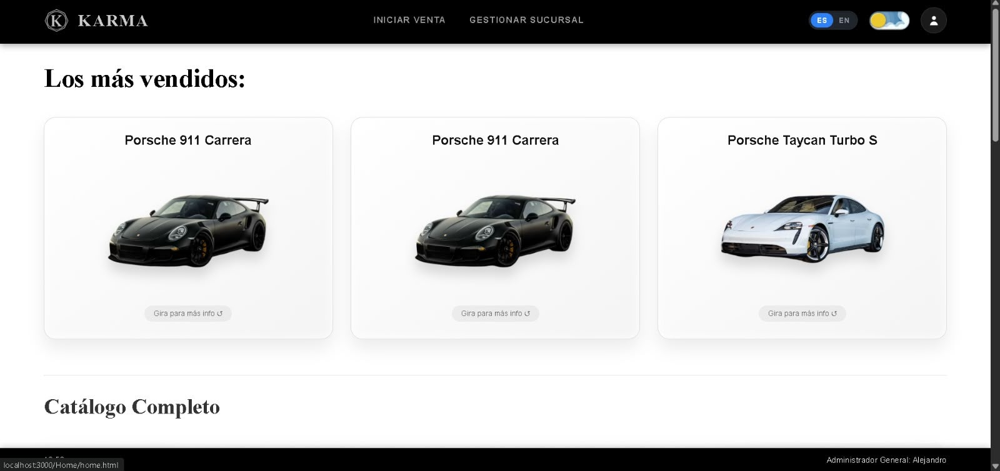

<div align="center">

<br>

<picture>
  <source media="(prefers-color-scheme: dark)" srcset="assets/logo-karma.png">
  <source media="(prefers-color-scheme: light)" srcset="assets/logo-karma-vector.svg">
  
</picture>

<h1>KARMA — Point of Sale &amp; Luxury Automotive Management</h1>

<p><em>Precision Engineering for High-End Mobility: Audi • Porsche • Ducati</em></p>

<p>
  
  
  
</p>

<sub>PROYECTO INTEGRADOR EN DESARROLLO · ENTORNO LOCAL XAMPP · SUCURSALES MANZANILLO Y COLIMA</sub>

<br>

<sub>
  <a href="#tecnologias">TECNOLOGÍAS</a> &nbsp;·&nbsp;
  <a href="#modulos">MÓDULOS</a> &nbsp;·&nbsp;
  <a href="#roles">ROLES</a> &nbsp;·&nbsp;
  <a href="#flujo">FLUJO</a> &nbsp;·&nbsp;
  <a href="#interfaz">INTERFAZ</a> &nbsp;·&nbsp;
  <a href="#instalacion">INSTALACIÓN</a>
</sub>

</div>

<br>

<a name="tecnologias"></a>
<p align="center"></p>
<h2 align="center">Ingeniería del sistema</h2>

<div align="center">

<table>
  <tr>
    <td align="center"><br><sub>POS, catálogo y API</sub></td>
    <td align="center"><br><sub>Lógica de caja</sub></td>
    <td align="center"><br><sub>Estructura</sub></td>
    <td align="center"><br><sub>Modo claro y oscuro</sub></td>
  </tr>
  <tr>
    <td align="center"><br><sub>Triggers y eventos</sub></td>
    <td align="center"><br><sub>API de login · Express</sub></td>
    <td align="center"><br><sub>Endpoints del POS</sub></td>
    <td align="center"><br><sub>Intercambio de datos</sub></td>
  </tr>
</table>

<sub>INTEGRACIONES</sub><br>


</div>

<br>

<a name="modulos"></a>
<p align="center"></p>
<h2 align="center">Una caja para toda la agencia</h2>

<table>
  <tr>
    <td width="50%" valign="top">
      
      <h3>Venta de vehículos</h3>
      Audi, Porsche y Ducati con VIN validado y vista 3D del modelo.<br>
      <sub>Contado en efectivo o crédito con enganche, contrato firmado y abonos en caja.</sub>
    </td>
    <td width="50%" valign="top">
      
      <h3>Refacciones</h3>
      Venta por código de barras o selección manual.<br>
      <sub>Existencias independientes por sucursal; también a la venta en la tienda en línea.</sub>
    </td>
  </tr>
  <tr>
    <td width="50%" valign="top">
      
      <h3>Servicios y garantías</h3>
      13 conceptos en caja: seguros, financiamiento, trámites e impuestos, posventa y taller.<br>
      <sub>Garantía de 4 años con cada vehículo vendido; las solicitudes desde caja las resuelve un gerente.</sub>
    </td>
    <td width="50%" valign="top">
      
      <h3>Catálogo web</h3>
      Sitio para clientes con carrito, apartados, citas y simulador de crédito.<br>
      <sub>Cada pedido llega a Web orders para cobrarse o cancelarse en caja.</sub>
    </td>
  </tr>
</table>

<br>

<a name="roles"></a>
<p align="center"></p>
<h2 align="center">Cada perfil, su alcance</h2>

<table>
  <tr>
    <td width="33%" valign="top">
      <h3>Administrador general</h3>
      Inicio administrativo, acceso al POS y panel de gestión de sucursales, personal, inventario y pedidos.<br>
      <sub>El panel de gestión aún usa datos de demostración.</sub>
    </td>
    <td width="33%" valign="top">
      <h3>Gerente de sucursal</h3>
      Inicio administrativo y acceso al POS. Resuelve, junto con el administrador, las solicitudes de garantía.<br>
      <sub>Regla en la base de datos; pantalla de aprobación pendiente.</sub>
    </td>
    <td width="33%" valign="top">
      <h3>Cajero / Asesor</h3>
      Opera el POS de su sucursal: ventas, servicios, créditos, abonos, garantías y Web orders.<br>
      <sub>Confirma cada operación sensible con su gafete.</sub>
    </td>
  </tr>
</table>

<div align="center">

<table>
  <tr>
    <td align="center"><b>bcrypt</b><br><sub>contraseñas</sub></td>
    <td align="center"><b>Gafete QR</b><br><sub>o código EMP</sub></td>
    <td align="center"><b>60 s</b><br><sub>permiso de un solo uso</sub></td>
    <td align="center"><b>CSRF</b><br><sub>en cada petición</sub></td>
    <td align="center"><b>Bitácora</b><br><sub>de autorizaciones</sub></td>
  </tr>
</table>

</div>

<br>

<a name="flujo"></a>
<p align="center"></p>
<h2 align="center">Contado y crédito, frente a frente</h2>



<br>

<a name="interfaz"></a>
<p align="center"></p>
<h2 align="center">Vistas del sistema</h2>

<p align="center">
  
  <br>
  <sub><b>PUNTO DE VENTA</b> · registro de venta y ticket</sub>
</p>

<p align="center">
  
  
  <br>
  <sub><b>CATÁLOGO DE VEHÍCULOS</b> · sitio para clientes &nbsp;&nbsp;|&nbsp;&nbsp; <b>INICIO ADMINISTRATIVO</b> · más vendidos y catálogo completo</sub>
</p>

<br>

<a name="instalacion"></a>
<p align="center"></p>
<h2 align="center">Puesta en marcha local</h2>

### Requisitos previos

| Herramienta | Versión | Uso |
| :--- | :--- | :--- |
| **XAMPP** | PHP 8 · MariaDB 10.4 | Apache, PHP y base de datos. Los scripts usan sintaxis de MariaDB. |
| **Git** | — | Clonar el repositorio |
| **Node.js** | Opcional | API de login con Express en el puerto 3000 |

### Preparación

```bash
cd C:/xampp/htdocs
git clone https://github.com/k-rozzu/PROYECTO_INTEGRADOR_KARMA.git KARMA
```

> Clona el proyecto en la carpeta `KARMA`: la pantalla de acceso llama a `/KARMA/PHP/Login/login.php`. Dompdf ya viene incluido en `PHP/PuntoDeVenta/vendor/`.

Para el envío de tickets por correo, la traducción ES / EN o el servidor Node, crea un archivo `.env` en la raíz. Git lo ignora y `.htaccess` bloquea su acceso desde el navegador.

```dotenv
# Base de datos (servidor Node)
DB_HOST=127.0.0.1
DB_PORT=3306
DB_USER=root
DB_PASSWORD=
DB_NAME=pos_multisede

# Ticket PDF por correo (Brevo)
BREVO_API_KEY=
BREVO_REMITENTE_EMAIL=
BREVO_REMITENTE_NOMBRE=

# Traducción ES / EN: deepl o google
TRADUCTOR_PROVEEDOR=deepl
DEEPL_API_KEY=
GOOGLE_TRANSLATE_API_KEY=
```

### Base de datos

Inicia MySQL en el panel de XAMPP y abre el cliente desde la carpeta `Database`:

```bash
cd C:/xampp/htdocs/KARMA/Database
C:/xampp/mysql/bin/mysql -u root --default-character-set=utf8mb4
```

Crea la base e importa el volcado completo (también puedes hacerlo desde phpMyAdmin):

```sql
CREATE DATABASE IF NOT EXISTS pos_multisede CHARACTER SET utf8mb4 COLLATE utf8mb4_unicode_ci;
USE pos_multisede;
SOURCE pos_multisede.sql;
```

> - `pos_multisede.sql` trae la estructura, los triggers, el evento de garantías y los datos de demostración. Los demás scripts de `Database/` actualizan bases creadas antes de este volcado.
> - El PHP se conecta a `pos_multisede` en `127.0.0.1` con el usuario `root` sin contraseña, los valores por defecto de XAMPP. Puedes cambiarlos con las variables de entorno `KARMA_DB_HOST`, `KARMA_DB_NAME`, `KARMA_DB_USER` y `KARMA_DB_PASS`.
> - Para que el evento de garantías siga activo al reiniciar, agrega `event_scheduler=ON` en la sección `[mysqld]` de `my.ini`.
> - Las cuentas de demostración vienen en el volcado; las contraseñas de los cajeros de prueba están en los comentarios de `catalogo_datos_demo.sql`.
> - **Pendiente:** el volcado no incluye la columna `usuarios.codigo_empleado` ni el trigger `auto_codigo_empleado`, que usa la autorización con gafete.

### Ejecución

Inicia **Apache** y **MySQL** en el panel de XAMPP.

| Acceso | Dirección |
| :--- | :--- |
| Inicio de sesión | `http://localhost/KARMA/` |
| Catálogo web | `http://localhost/KARMA/PHP/Catalogo/index.php` |
| Punto de Venta | `http://localhost/KARMA/PHP/PuntoDeVenta/index.php` |

El servidor Node es opcional: expone `/api/login` y sirve los archivos estáticos en `http://localhost:3000`. La pantalla de acceso usa la versión PHP, así que el POS y el catálogo necesitan Apache.

```bash
npm install
node backend/server.js
```

<br>

<div align="center">

<sub>EQUIPO KARMA</sub><br>
<sub>Ibarra Heredia Alan Alejandro · Martinez Zuñiga Carolina · Nava Montiel Miranda Lizet · Vázquez Atanacio Diego Alejandro · Nava Montiel Dana Paola</sub>

</div>
